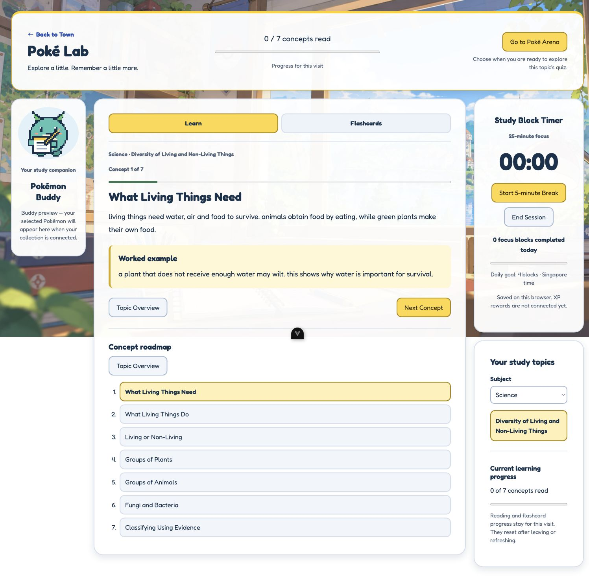
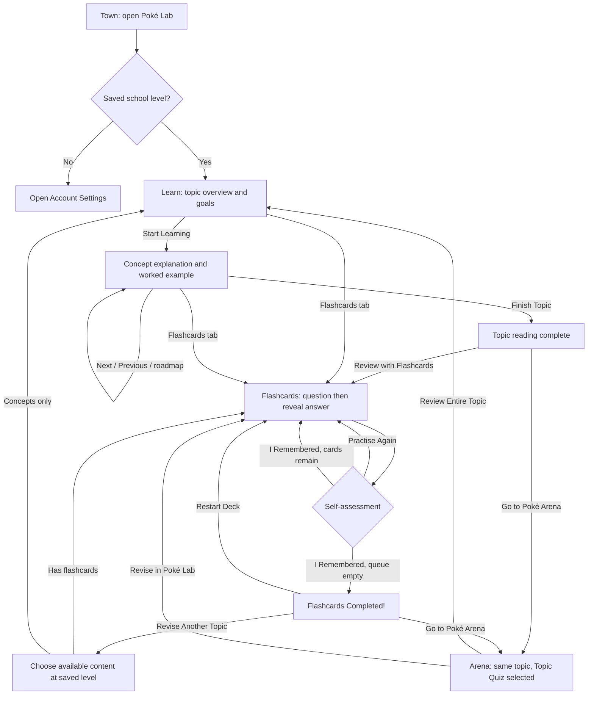
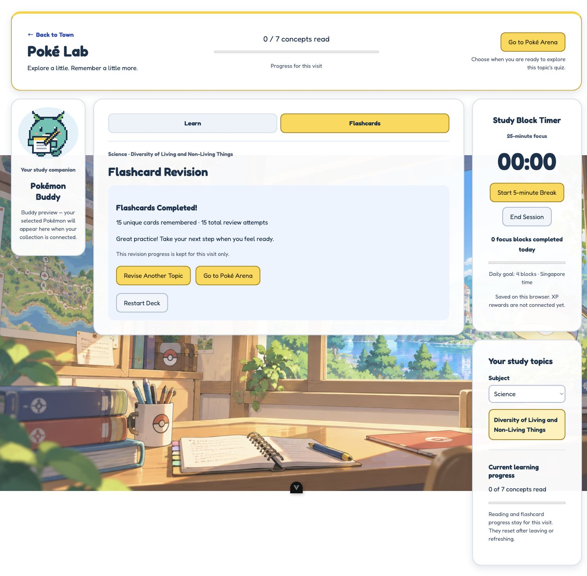
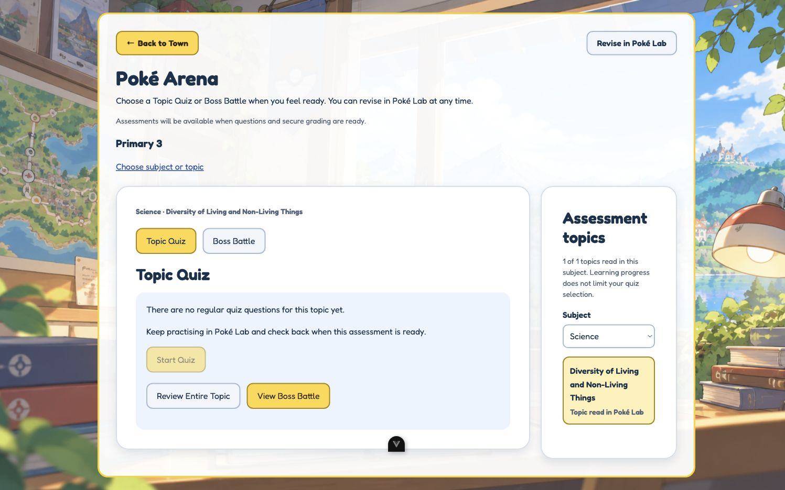

# Poké Lab — current behaviour and visual guide for ChatGPT

**Project:** StudyDex  
**Snapshot:** 27 October 2026, Singapore time  
**Scope:** Current local implementation, including uncommitted changes. This describes what exists now, not a proposed redesign.

## How to use this document

Upload this Markdown file to ChatGPT, then describe the feedback or changes you want. The wireframes and behaviour descriptions work on their own. For feedback on the actual appearance, also attach the three JPGs in `images/poke-lab/`; a Markdown upload may not load its relative image links.

Suggested message to send with it:

> This document describes my current StudyDex Poké Lab. Use it as the baseline when explaining or visualising the app. Keep existing behaviour separate from proposed changes. Read the screen layouts, interaction rules, persistence table and current limitations before suggesting anything. If you create a mockup, preserve the current Learn/Flashcards tabs, buddy panel, timer and topic browser unless I ask to change them. Tell me which screen or state each suggestion affects.

## 1. What Poké Lab does

Poké Lab is the learning and revision area of a Pokémon-themed study app for primary school students. A student reads concepts and worked examples, then practises recall with flashcards. A Pokémon companion and an optional focus timer sit alongside the learning content.

| Area | Route | Current purpose |
| --- | --- | --- |
| Town | `/home` | Entry point with building links, including Poké Lab and Poké Arena |
| Poké Lab | `/study-decks` | Learn, Flashcards, study buddy, focus timer and topic selection |
| Poké Arena | `/quiz` | Separate Topic Quiz/Boss Battle selection and ungraded question previews |

Both Lab and Arena require login. Topics are filtered using the student's saved `school_level_id`, not a level supplied in the URL. Without a school level, the student sees **Set your school level first** and an **Open Account Settings** link. No level is assumed.

On ordinary Lab entry, Learn is selected and the first available topic for the selected/default subject opens. The student can change subjects and topics in the topic browser. They can also enter Flashcards directly without finishing Learn.

## 2. Picture the desktop screen

Imagine an illustrated Pokémon study room behind rounded, almost-white panels. Dark navy text, yellow active tabs and buttons, soft blue secondary controls and green progress bars give it a friendly classroom feel.

```text
┌──────────────────────────────────────────────────────────────────────────────┐
│ ← Back to Town             0 / 7 concepts read        [Go to Poké Arena]     │
│ Poké Lab                   ░░░░░░░░░░░░░░░░░░░░       Choose when ready      │
│ Explore a little.          Progress for this visit                           │
│ Remember a little more.                                                     │
└──────────────────────────────────────────────────────────────────────────────┘

┌─────────────┐  ┌──────────────────────────────────────┐  ┌───────────────────┐
│ Buddy art   │  │ [ Learn — active ] [ Flashcards ]     │  │ Study Block Timer │
│             │  │──────────────────────────────────────│  │ 25-minute focus   │
│ Your study  │  │ Science · Current topic              │  │       25:00       │
│ companion   │  │                                      │  │ [Start Study      │
│             │  │ Current learning screen:             │  │  Session]         │
│ Pokémon     │  │ overview, concept, flashcard          │  │                   │
│ Buddy       │  │ or completion summary                │  │ Today's blocks    │
│             │  │                                      │  │ Daily goal: 4     │
│ Saved stats │  │ Concept roadmap appears in Learn     │  └───────────────────┘
│ or preview  │  │ below its current content            │  ┌───────────────────┐
└─────────────┘  └──────────────────────────────────────┘  │ Your study topics │
                                                          │ Subject [Science] │
                                                          │ [Current topic]   │
                                                          │ Reading progress  │
                                                          └───────────────────┘
```

The centre gets most of the space. On large displays the grid is **190px buddy / flexible content / 280px utilities**, with 20px gaps and a maximum overall width of 1640px. The roadmap belongs inside the central Learn panel; it is not a separate desktop sidebar.

| Visual element | Current styling |
| --- | --- |
| Background | `/backgrounds/morning_homepage.png`, centred, covering the page, fixed |
| Typography | Fredoka, with a sans-serif fallback; large rounded headings |
| Text | Navy `#17324d`; explanation text is about 18px with generous line spacing |
| Panels | Almost-white `#fffffff5`, light borders, soft shadows, 24px corner radius |
| Primary buttons / active tabs | Yellow `#ffd841` with a darker gold border |
| Secondary controls | Pale blue-grey `#f1f5fb` |
| Worked examples | Pale yellow `#fff7d5` with a gold left border |
| Flashcard question / answer | Pale blue question face, pale yellow answer face; horizontal flip |
| I Remembered | Pale green button |

### Actual Learn screenshot



This is an existing browser capture from the verification recorded on 27 October 2026. The timer happens to show a completed focus state at `00:00`; a fresh idle timer starts at `25:00` and waits for the student to press Start Study Session. The screen above is a concept, while fresh ordinary Learn entry opens the overview first.

### Responsive layout

- **Above 1200px:** buddy, learning content and utilities are three columns.
- **At 1200px and below:** the buddy becomes a compact full-width row above the content and utilities; utilities use a 270px column.
- **At 848px and below:** the content becomes one column; the timer and topic browser sit beside each other below it.
- **At 576px and below:** the header sections, timer and topic browser stack vertically. Panels use smaller padding and 18px corners.

The CSS breakpoints are 75rem, 53rem and 36rem respectively. Buttons are keyboard accessible, focus outlines are visible, and reduced-motion preferences disable the flip transition.

## 3. Student journey



The header's **Go to Poké Arena** button is also available whenever a topic is selected. Completing Learn or Flashcards is optional for entering Arena. Navigation to Arena selects the topic; it does not start an assessment.

If Mermaid does not render, the main flow is: **Town → Lab overview → concepts → reading completion → Flashcards → flashcard completion → another topic or Arena.** The tabs and topic browser allow switching earlier.

## 4. Learn mode, screen by screen

### A. Topic overview

The centre panel shows the subject/topic label, topic name, description, an ordered list of learning goals, concept count and **Start Learning**. The concept roadmap is available underneath.

```text
[ Learn ] [ Flashcards ]
Science · Diversity of Living and Non-Living Things

Topic overview
Diversity of Living and Non-Living Things
<Topic description from the database>

Your learning goals
1. <First goal>
2. <Second goal>

7 concepts · Learn at your own pace
[Start Learning]

Concept roadmap
[Topic name / overview]
1. [First concept]
2. [Second concept] ...
```

### B. Reading a concept

Only one concept is shown at a time, in database order:

```text
Concept 1 of 7
████░░░░░░░░░░░░░░░░░░   ← current position
What Living Things Need

<Explanation, preserving its original line breaks>

┌ Worked example ───────────────────────────────────┐
│ <Example text, if this concept has one>            │
└───────────────────────────────────────────────────┘

[Topic Overview]                         [Next Concept]

Concept roadmap
[Topic name / overview]
1. [What Living Things Need — current]
2. [What Living Things Do]
3. [Living or Non-Living] ...
```

- The first concept has **Topic Overview** on the left. Later ones have **Previous Concept**.
- The forward button is **Next Concept**, changing to **Finish Topic** on the final concept.
- A roadmap button can open any concept. The current entry is highlighted; acknowledged entries show **Read**.
- Pressing Next Concept or Finish Topic adds that concept once to the visit's read count. Opening a concept or jumping past one does not mark it read.
- The concept position bar and the header's concepts-read bar measure different things: position in the lesson versus distinct concepts acknowledged.
- Jumping to the final concept and pressing Finish Topic can open the completion screen while earlier concepts remain unread. The summary reports the actual count.
- Learn currently contains explanations and examples. It does **not** load or display MCQ/True-False quick checks.

### C. Reading completion

```text
Topic reading complete
You have explored <Topic Name>!
7 of 7 concepts read. Choose your next step.

[Review with Flashcards]   [Go to Poké Arena]
[Revisit Concepts]
```

The student stays in Lab until choosing an action. Review with Flashcards opens the same topic's deck. Revisit Concepts opens the overview and roadmap. Topic completion is recorded as local reading history; it is not a grade or proof of mastery.

## 5. Flashcards mode

Cards begin in `card_order`. Each card has question text, answer text and optional images on either face. The student can click the card, or use Enter/Space while it is focused, to flip it.

```text
Flashcard Revision
Card 3 of 15
2 / 15 remembered · 13 still to review
██░░░░░░░░░░░░░░░░░░░░

┌───────────────────────────────────────────────────┐
│                     Question                      │
│              <Current question text>              │
│                <Optional image>                   │
│       Click or press Enter to reveal the answer   │
└───────────────────────────────────────────────────┘

After flipping:
┌───────────────────────────────────────────────────┐
│                      Answer                       │
│               <Current answer text>               │
│                <Optional image>                   │
│           How well did you remember it?           │
└───────────────────────────────────────────────────┘
             [I Remembered] [Practise Again]
```

The two recall buttons appear **only after revealing the answer**.

| Action | Effect |
| --- | --- |
| I Remembered | Removes the current card from the active queue and adds its unique ID to remembered cards |
| Practise Again | Puts the current card after the next queued card; if it is the only card, it stays available |
| Either accepted action | Adds one review attempt, advances the queue and returns to the question face |
| Restart Deck | Resets the deck queue, remembered count, attempts and flipped state |

For example, `[A, B, C]` becomes `[B, A, C]` when A gets Practise Again. Remembering A instead leaves `[B, C]`. Repeated practice can make attempts exceed the number of unique cards. Duplicate source IDs do not inflate the deck count. The displayed Card number is the card's original deck position, so it can move backwards when a card returns.

There are no separate Again/Hard/Easy controls in the current version, and no time-based spaced-repetition schedule. These are self-reported recall actions.

### Flashcard completion

When every unique card has been remembered, the queue is empty and the student sees:

```text
Flashcards Completed!
15 unique cards remembered · 17 total review attempts
Great practice! Take your next step when you feel ready.
This revision progress is kept for this visit only.

[Revise Another Topic]   [Go to Poké Arena]
[Restart Deck]
```

The numbers above illustrate a 15-card deck with two Practise Again actions. Actual counts depend on the student's actions.



The existing screenshot shows a different completed run: 15 unique cards remembered in 15 attempts.

**Revise Another Topic** opens a chooser in the central panel and keeps the saved school level. It lists the level's topics, including the just-completed topic. Availability is checked before enabling a topic: topics with cards open Flashcards; concepts-only topics open Learn. Loading, unavailable content and errors have explicit messages, with retries for errors. If there is no other populated topic, the student is told they can revisit the current one. Returning to a completed deck during the same Lab visit preserves its completion until Restart Deck is chosen.

## 6. Buddy and focus timer

### Pokémon companion

The left panel reads the student's selected Pokémon and displays its sprite, name, saved level and XP. If none is selected, it displays the existing buddy artwork and preview message. Buddy loading/failure does not replace the lesson with an error.

Studying does not currently change the buddy's XP or level. This panel displays saved data.

### Study Block Timer

- A fresh session is **25 minutes of focus**. Nothing starts automatically.
- Controls follow the current state: **Start Study Session → Pause / Resume → Start 5-minute Break**. **End Session** is available once a session exists.
- The five-minute break starts only when the student chooses it. After the break, a new focus block also needs an explicit start.
- Changing Lab tabs, subjects or topics keeps the same running timer rather than resetting it.
- Leaving Lab, including going to Arena or Town, pauses it. Browser page exit/refresh also attempts to pause it; interrupted running sessions recover paused.
- Completed focus blocks are counted by Singapore calendar day. The goal is four blocks; students can continue beyond four.
- Recoverable timer state is saved per student in this browser. Storage failures have a visible notice.
- Offline/unobserved intervals do not automatically create recovered completions. Local timer records do not award XP or other rewards.

The separate `/timer` prototype is not the timer used by Poké Lab.

## 7. Arena handoff and current limits

Lab's Arena actions preserve the subject/topic and open **Topic Quiz**, even if the student previously visited Boss Battle. The student can then choose Topic Quiz or Boss Battle inside Arena. Learning completion does not gate topic selection.



Current behaviour:

- An empty regular quiz bank shows an explanation and a disabled **Start Quiz** button.
- When a question bank has content, an explicit **Preview Questions** action opens ungraded questions. Start Quiz/Start Boss Battle remain disabled because secure grading is not connected.
- A preview allows answer selection, question navigation and **Review my choices**. Choices are visit-only and are not submitted or graded.
- **Revise in Poké Lab** returns to the same topic's Flashcards. **Review Entire Topic** returns to its Learn overview.
- Quiz questions, Boss Battle questions and quick checks remain separate content purposes.

**Not implemented:** trusted assessment scores, pass/fail results, saved graded attempts, graded-quiz retries, automatic weak-concept detection or study/assessment XP rewards. A 50% pass threshold is described in the existing future grading specification; it is not functioning assessment behaviour today.

Targeted concept-review links already work as navigation: matching concepts open and show **Revisit** in the roadmap. Foreign/missing concept IDs fall back to the overview. A link is a revision hint, not evidence that the student answered anything incorrectly.

## 8. What is saved, and for how long?

| State | Current lifetime |
| --- | --- |
| Selected subject/topic and mode | Represented in route query parameters; a matching URL can reopen that context |
| Current Learn step and distinct read count | Cached per topic during this Lab visit; reset after leaving Lab or refreshing |
| Flashcard queue, remembered cards and attempts | Cached per topic during this Lab visit; reset after leaving Lab or refreshing |
| Topic-completion flag | Browser localStorage, scoped to student and school level; in-memory fallback when storage fails |
| Timer and local focus-completion history | Browser localStorage, scoped to student; interrupted sessions recover paused |
| Buddy level and XP | Existing saved database values, displayed read-only by Lab |
| Arena preview choices | Current Arena visit only; no graded-attempt persistence |

The completion flag and the visit's read counter are separate. A topic can retain its local completion flag after a refresh while the new visit shows 0 concepts read. Local completion does not unlock assessments, prove mastery or authorize rewards.

## 9. Content and loading

The frontend uses Vue 3, Vue Router and the existing Supabase client. It loads the current profile, then subjects and level-filtered topics. The selected topic's lesson and flashcards load independently and are cached for the Lab visit. Mode switching uses Vue `KeepAlive` so the student's position is retained during that visit.

| Content | Existing source |
| --- | --- |
| Student's registered level | Profile service: `profiles` with related level data |
| Subject/topic browser | `subjects`, `topics`; topics filtered by saved school level |
| Overview goals | `topic_learning_goals`, ordered by `goal_order` |
| Concepts and examples | `topic_concepts`, ordered by `concept_order` |
| Flashcards | `flashcards`, ordered by `card_order` |
| Buddy | Student's selected `user_pokemon` and related `pokemon` |
| Arena previews | `questions` filtered by purpose, plus ordered `question_options` |

Learn does not request questions or answer keys. The study service uses explicit display fields. Lab's study interactions do not write educational content, grades, sessions or rewards to the database. Reading permissions still govern which rows are visible.

Missing content has an empty state; failed requests have error/retry states. Goals and concepts load independently, so a goals failure can be reported without discarding successfully loaded concepts. No topic concepts means Start Learning is unavailable; an empty flashcard deck offers **Back to Learn**. Unavailable topics do not fall back to fabricated lessons.

Optional card images can use site-root paths or HTTPS URLs. Public storage object paths require the configured `VITE_STUDY_ASSET_BUCKET`; private signed-image delivery is not implemented. Missing/failed images have a fallback.

### Concrete pilot example

The latest repository verification report, dated 27 October 2026, records **Primary 3 → Science → Diversity of Living and Non-Living Things** with:

- 7 concepts: What Living Things Need; What Living Things Do; Living or Non-Living; Groups of Plants; Groups of Animals; Fungi and Bacteria; Classifying Using Evidence.
- 15 flashcards.
- 7 quick-check records, which are not used by current Learn.
- 2 Boss Battle preview questions.
- 0 regular quiz questions.

These are reported pilot counts, not a fresh database inventory or a guarantee that other levels have the same content. No live database queries or new browser tests were performed to prepare this guide. The screenshots were copied from that existing verification session.

## 10. Navigation examples and code map

Replace placeholders with real IDs; school level always comes from the saved profile.

```text
Learn:
/study-decks?subject=<subject_id>&topic_id=<topic_id>&mode=learn

Flashcards:
/study-decks?subject=<subject_id>&topic_id=<topic_id>&mode=flashcards

Lab → regular Arena selection:
/quiz?subject=<subject_id>&topic_id=<topic_id>

Arena Boss Battle:
/quiz?subject=<subject_id>&topic_id=<topic_id>&battle=boss

Review entire topic:
/study-decks?subject=<subject_id>&topic_id=<topic_id>&mode=learn&review=topic

Targeted concept navigation:
/study-decks?subject=<subject_id>&topic_id=<topic_id>&mode=learn&review=concepts&concept_ids=<concept_id>

Revise Another Topic:
/study-decks?view=topics&mode=flashcards&from_topic_id=<topic_id>
```

`topic_id` is canonical; legacy `topic` links remain accepted, with `topic_id` taking precedence. Old Lab links using `mode=quiz` or `mode=boss_battle` redirect to Arena behind authentication. Switching subjects through the normal topic browser opens the first available topic in Learn; choosing a topic there also opens Learn.

| File | Responsibility |
| --- | --- |
| `src/views/studyView.vue` | Lab layout, profile/content loading, selection, component caches and Arena handoff |
| `src/components/study/StudyLearn.vue` | Overview, concept reader, roadmap and reading-completion screen |
| `src/components/study/StudyFlashcards.vue` | Card faces, recall buttons and completion screen |
| `src/composables/useFlashcardReview.js` | Unique deck, queue, remembered cards and attempts |
| `src/components/study/StudyTimerPanel.vue` | Timer presentation and controls |
| `src/components/timer/useTimer.js` | Shared focus/break state, pause/recovery and local daily counts |
| `src/composables/useTopicCompletion.js` | Local topic-completion history |
| `src/services/studyService.js` | Content/buddy reads, image paths and readable errors |
| `src/utils/studyNavigation.js` | Shared topic and revision-link handling |
| `src/assets/study.css` | Lab styling, responsive layout and flashcard transition |
| `src/views/quizView.vue` and `src/components/study/StudyQuiz.vue` | Separate Arena topic selection and preview UI |
| `src/router/index.js` | Routes, login protection and legacy assessment redirects |

For further repository context, see `docs/lab-arena-separation.md` and `docs/learning-flow-test-report.md`. Older implementation notes describe superseded quick checks inside Learn and Again/Hard/Easy flashcard controls; use the current behaviour in this document.
